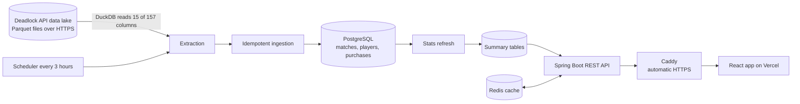

# Deadlock Meta Companion

[](https://github.com/Ali-BenOtman/deadlock-meta-companion/actions/workflows/ci.yml)

A hero tier list, win rates and item stats for Valve's *Deadlock*, built from a sample of real ranked matches and refreshed every three hours.

**Live site:** https://deadlock-meta-companion.vercel.app
**API example:** https://207-180-227-65.sslip.io/api/meta

I built this to learn how to run a small, data-heavy backend end to end: pulling bulk data from a public source, loading it safely, turning tens of millions of rows into fast answers, and running it on a real server. The interesting parts are the data pipeline, the precomputed statistics and the measured performance work. The decisions behind them are written down in [`docs/decisions.md`](docs/decisions.md).

## What it does

- **Tier list.** Every hero ranked S to D by smoothed win rate, with weekly trend arrows, a rank filter, search, sorting and a "biggest movers" strip.
- **Hero pages.** Win rate, pick rate and games, the most-played starting builds, and the items with the best win rate against the hero's own average, with the median time players buy them.
- **Rank filter.** Every number can be limited to a minimum rank, from Obscurus to Eternus.
- **Automatic updates.** New ranked matches are collected every three hours and every statistic is recalculated.

## How it works



1. **Collect.** The community Deadlock API publishes match data as Parquet files. DuckDB reads only the 15 columns needed (of 157) straight from the HTTPS addresses and filters to ranked matches, so one partition is about 40 MB instead of several GB.
2. **Store.** Rows are loaded into PostgreSQL in batches. Ingestion is idempotent (`ON CONFLICT DO NOTHING`, one transaction per file), and a file is recorded as processed only after it succeeds, so a crash at any point is safe to re-run.
3. **Calculate.** A refresh job turns the raw rows into small summary tables per hero and rank, inside one transaction, so the old numbers stay readable until the new ones commit.
4. **Serve.** A Spring Boot API reads the summary tables, with Redis in front. The cache is cleared only after a refresh has committed.
5. **Display.** A React single-page app on Vercel calls the API.

Data is kept for 21 days, and statistics use the 14 days before the newest match, which is roughly 290,000 ranked matches at the time of writing.

## Measured results

These are numbers I measured while building it, not estimates. Details are in [`docs/decisions.md`](docs/decisions.md) and [`docs/data-notes.md`](docs/data-notes.md).

| What | Before | After |
|---|---|---|
| Hero stats, computed per request (87M item rows) | 3.6 s | 0.007 s (precomputed summary tables) |
| Item stats per hero | 4 to 32 s | 0.009 s |
| Build stats per hero | timed out after 300 s | 0.108 s |
| Stats refresh, laptop (shared window tables) | 328 s | 164 s, identical results |
| Database size after the first retention run | 15 GB | 8.2 GB (deleted 140,304 old matches in 51 s, then `VACUUM FULL`) |
| Ingestion speed | | about 5,600 rows per second with batched inserts |
| Full data update on the server | | about 8 to 16 minutes, varying with the shared CPU |
| Backend test suite | | 22 tests in about 25 seconds |

## Key design decisions

The full list is in [`docs/decisions.md`](docs/decisions.md). A few that shaped the project:

- **Bulk data lake instead of the REST API.** No rate limit and no credentials, and column pruning keeps downloads small (decisions 1 and 17).
- **Plain SQL with `JdbcTemplate` instead of JPA.** The workload is bulk inserts and aggregate queries, where writing the SQL directly is faster and clearer (decision 2).
- **Idempotent ingestion with at-least-once processing.** Duplicate rows are rejected by primary keys, and every file is its own transaction (decisions 4, 7 and 9).
- **Precomputed summary tables, summed on read.** Counts add exactly across ranks, and win rates are recomputed from summed counts, never by averaging percentages (decision 19).
- **Smoothed win rates.** `(wins + 200 × 50%) / (games + 200)`. The prior is exactly 50% because every match has six winners and six losers, so a hero with few games is not ranked on a lucky streak (decision 16).
- **Items ranked by difference from the hero's own win rate.** A raw 57% means little for a hero who already wins 56% (decision 14).
- **Starting builds, not full builds.** I measured it: players holding 12 items had tens of thousands of distinct builds per hero, with almost none repeated 30 times, so complete builds cannot be ranked honestly (decisions 15 and 30).
- **A hang I diagnosed instead of guessing.** Batched inserts froze during ingestion. `pg_stat_activity` showed PostgreSQL waiting on the client while a thread dump showed Java blocked writing to the socket. I removed the driver option responsible and added a socket timeout so a future stall fails instead of hanging (decision 18).

## API

All endpoints are `GET`, read-only and need no authentication. `minTier` is a rank from 0 (Obscurus) to 11 (Eternus); it keeps matches at that rank or above.

| Endpoint | Returns |
|---|---|
| `/api/meta?minTier=` | Every hero with tier, smoothed and raw win rate, pick rate, games, weekly trend and image |
| `/api/heroes/stats?minTier=` | Per-hero stats |
| `/api/heroes/{id}/items?minTier=` | Items for a hero: buyers, buy rate, win rate, difference from the hero average, median buy time |
| `/api/heroes/{id}/builds?minTier=` | The most-played first six items (at least 30 games) with win rate |
| `/actuator/health` | Health check |

An invalid `minTier` returns 400, and an unknown hero returns 404 before the cache or database is touched.

## Security

- Caddy is the only public service. It serves HTTPS with automatic certificates and sets HSTS, a strict CSP, `nosniff`, frame denial and no-referrer headers. PostgreSQL, Redis and the backend listen on `127.0.0.1` only, because Docker's published ports bypass the host firewall.
- Developer endpoints exist only under the `dev` Spring profile, and Caddy also blocks `/api/dev/*` and the internal actuator paths, so there are two independent layers.
- Redis requires a password, the database password lives in an untracked `.env`, and error responses contain no stack traces.
- Queries use bound parameters. Steam account IDs are used only to prevent duplicates and are never returned by the API.
- CORS allows `GET` on `/api/**` only from the site's own origin, set through configuration, and two integration tests check it.
- Graded A+ by both SSL Labs and securityheaders.com at the time of writing.

## Testing and CI

- 22 tests: 9 unit tests for the tier and trend rules, and 13 integration tests that start real PostgreSQL 17 and Redis 7.4 containers with Testcontainers. Flyway builds the schema from scratch on every run, and test data is generated with DuckDB with known outcomes, so expected values can be worked out by hand.
- GitHub Actions runs the backend tests and a Docker build, and a separate frontend job runs lint and the production build. Both are required checks on `main`, and Dependabot keeps Maven, Docker, Actions and npm up to date.

## Run it locally

Requirements: Docker, Java 17 and Node 22.

**Frontend only (quickest).** The dev server proxies `/api` to the live API, so you can look around without a database:

```bash
cd frontend
npm ci
npm run dev
```

**Backend with its own database.**

```bash
cp infra/.env.example infra/.env    # then set the passwords
docker compose -f infra/docker-compose.yml up -d postgres redis
cd backend
./mvnw spring-boot:run -Dspring-boot.run.profiles=dev
```

On Windows PowerShell, use `Copy-Item infra/.env.example infra/.env` and `.\mvnw.cmd spring-boot:run "-Dspring-boot.run.profiles=dev"` (the quotes matter).

The `dev` profile enables the developer endpoints that run the update job by hand. Loading history into an empty database is a manual backfill, described in [`docs/decisions.md`](docs/decisions.md) (decisions 17 and 21) and [`docs/data-notes.md`](docs/data-notes.md). To point the frontend at your backend, set `VITE_API_URL`.

**Tests** (Docker must be running):

```bash
cd backend
./mvnw test        # Windows: .\mvnw.cmd test
```

## Deployment

The backend runs as four containers (PostgreSQL, Redis, the Spring Boot app and Caddy) with Docker Compose on a single VPS, with memory limits per container. The frontend is a static build on Vercel and redeploys on every merge to `main`. Backend deploys are manual: pull, rebuild the backend container, recreate Redis. An external monitor checks `/actuator/health`.

## Limitations

I would rather state these than have them found:

- **It is a sample, not every match.** The data comes from a community collection, and I can't see how representative it is.
- **No region split.** The data has no server or region field, so a hero that is strong in one region and weak in another looks average.
- **Item win rates are correlational.** Players who are ahead buy items sooner and win more, so a high item win rate does not prove the item is strong.
- **New heroes lag.** Tiers use 14 days, so a hero that just released or was reworked takes a while to settle.
- **Tiers are measured against 50%,** not against the other heroes, and trends need at least 500 games in each of the last two weeks.
- **Not patch-aware.** The 14-day window can span more than one game patch.
- **Ranked only.**
- **Single server.** There is one VPS and no automated backups yet, although the database can be rebuilt from the data lake.
- **Cache format.** Redis stores Java-serialised objects, so changing a cached class needs a cache flush. JSON would be more robust.
- **Refresh time grows with data.** The refresh recomputes everything; an incremental refresh would be the next step if it gets slow.

## Data and disclaimer

Match data comes from the community [Deadlock API](https://deadlock-api.com) data lake. This project is completely not affiliated with or endorsed by Valve. *Deadlock* and its heroes, items and images belong to Valve.

## Project layout

```
backend/    Spring Boot application, Flyway migrations, tests
frontend/   React + TypeScript single-page app (Vite)
infra/      Docker Compose, Caddy configuration, .env.example
docs/       decisions.md (design decisions), data-notes.md (measurements)
.github/    CI workflow and Dependabot configuration
```
